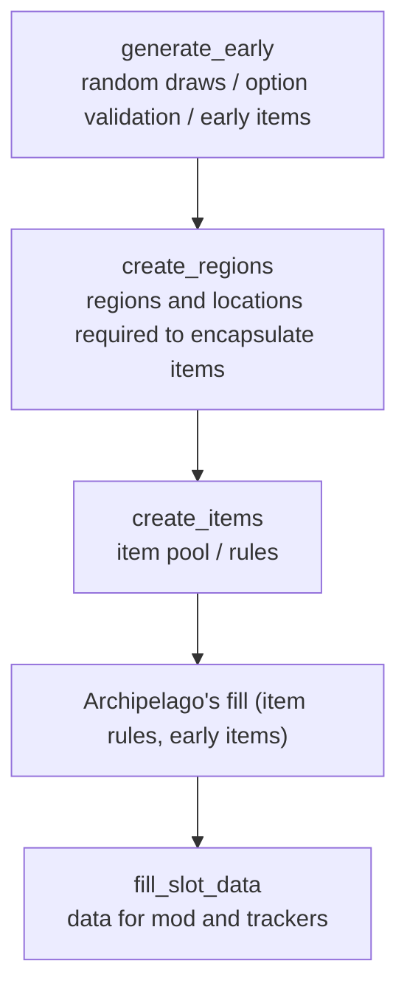

# apworld/

## Folders and files

```
apworld/bigwalk/
├── __init__.py
├── archipelago.json      
├── world.py              
├── generation.py         ensure fill process works finely even in tiny locations seeds, also treats random options draw
├── regions.py            
├── locations.py          
├── checks.py             
├── items.py                         
├── monuments.py          computes the monument order and repartition
├── logic_export.py              
├── tiles.py              drawns randomly tiles for the mod
├── web_world.py          
├── data/                 contains all game related data necessary to compute logic
│   ├── ...
│   ├── objects.py        contains GUID for every object in object_sanity option
│   └── zones.py          contains GUID for zone locking
├── options/              contains every options the apworld has, separated by section (QoL, deathlink, goal, logic, etc..)
├── rules/                contains every rules ordered by type (towers, objectives, etc..)
├── docs/                 contains the needed setup doc and web page like presentation
└── test/                 contains every test suite for the main options (those who changes logic and locations) and special cases
```

## How a seed is built
Big Walk generation follow this kind of build :


## The logic, in plain words
As Big Walk is a pretty straight openworld by default. Multiples options allow to remove this possibility and make the game more progression required, here is a list :
- Regions :
    - Starting Zone
        - always opened at start and containing the few puzzles everyone knows from the start
    - Big Walk
        - the vast open-world is opened differently depending your rules :
            - with `linear_arch_doors`, only `Drawbridge` is required.
            - if `First Arch Door` is closed : `Drawbridge` or `First Arch Door`
            - if `lock_abilities` is on, `Legs` will constraint also
            - if none of these rules are on, then you're free to get in as soon as you start playing !
    - Past the Chairlift
        - this area contains every vanilla late game / post-game locations and is opened here by `Chairlift` item
    - Past the Tunnels
        - depending on your options (`tunnel_sanity` or not) it is required to get at least one `colour's Tunnel Door` or `Tunnels`
    - Ending Zone
        - opened by going to the Chapel, which requires opening the `Big Wall Door`
    - Past the Spawn Secret Door
        - opened by `Spawn Secret Door` item.
- Puzzle requirements (such as buttons, timed tomatoes or even tiles and pebbles)
- Player movement skills (jump, pointing at with left or right arm, etc..)
- Monuments (places were gourd belongs)

Other tricky options exists and ables to randomize the order you will run your game : 
- `tower_mode`
    - `all_open` : play the game chill with every tower opened at start
    - `in_order` : one tower opened at a time but with a twists, this choice is random !
    - ``by_item` : same as `in_order` but you might ask for other to find your `Progressive Monument` to open them.
- `gauntlet_mode`
    - with `vanilla` flavour, everything is the same as the original game.
    - with `locked_stages` things become funny because you need to unlock every stage (see `Progressive Gauntlet Door` or `Gauntlet Stage X Door` depending on the option) to get to the top floor. And it also adds checks in this faraway place.

## Important to note
Ids were given at start of the project to compute a range of specified items.
They mustn't be changed, if any addition would be made it would be on top of these. Never use a retired id.

## Tests

The tests covers most of the logic-related options, and ensure short edge-cases are taken in account.

A fuzzer CI (see fuzz.yml) is also available to test out if a new apworld option related to generation and logic does work well or not.

## Build

From an Archipelago source checkout with the world linked (see below):

```
python Launcher.py "Build APWorlds" -- "Big Walk"
```

Produces `build/apworlds/bigwalk.apworld` in the checkout, to be copied into the
`custom_worlds/` folder of an Archipelago installation (0.6.7 or newer).

## Development and tests

To work with Archipelago's own tests, link the world's folder into a source
checkout of Archipelago rather than copying it:

```
mklink /J "<checkout>\worlds\bigwalk" "<here>\apworld\bigwalk"
```

Then, from the checkout:

```
set AP_TEST_WORLDS=bigwalk
python -m pytest worlds/bigwalk/test -q     # the world's own tests
python -m pytest test/general -q            # Archipelago conformance
```

## Trackers

**Universal Tracker**: supported, and no YAML is needed for it:
`interpret_slot_data` hands the seed's own settings back to UT, which rebuilds
the world from those instead of from whatever sits in the tracking player's
`Players` folder.

**Other trackers** (PopTracker packs): slot_data carries the whole logic as
data in `logic`: regions, exits and every rule, by item and location name.
Evaluating it keeps a tracker in step with the apworld without porting the
rules by hand. Built by [`bigwalk/logic_export.py`](bigwalk/logic_export.py):

| Key | Content |
|---|---|
| `origin` | the region the players start in |
| `rules` | every distinct rule once; index 0 is always `["true"]` |
| `exits` | `[from region, to region, rule index]` for every entrance |
| `locations` | `[name, id, region, rule index, event item]`; id 0 and an event item name for an event, `""` for a real check |

A rule is a nested list:

| Rule | True when |
|---|---|
| `["true"]` / `["false"]` | always / never |
| `["and", [rules]]` / `["or", [rules]]` | all / any of the rules |
| `["has", item, count]` | at least `count` of `item` received |
| `["all", [items]]` / `["any", [items]]` | one of each / one of any |
| `["from", [items], count]` | at least `count` items in total among the list |
| `["loc", location]` | that location is reachable (its region and its rule) |
| `["reg", region]` | that region is reachable |

Reachability is a sweep from `origin`: a region is reached through an exit
whose rule holds, a location when its region is reached and its rule holds.
An event location gives its event item once reached, which can open more,
so repeat until nothing changes.
