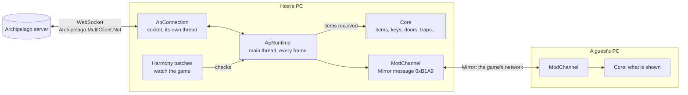
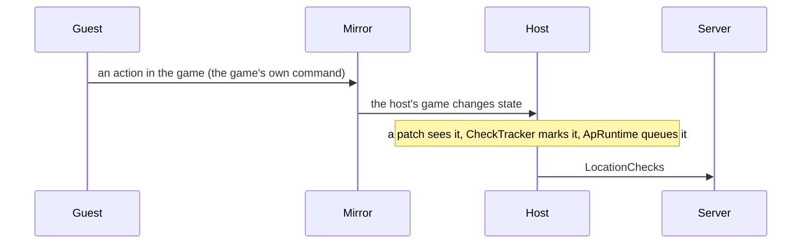
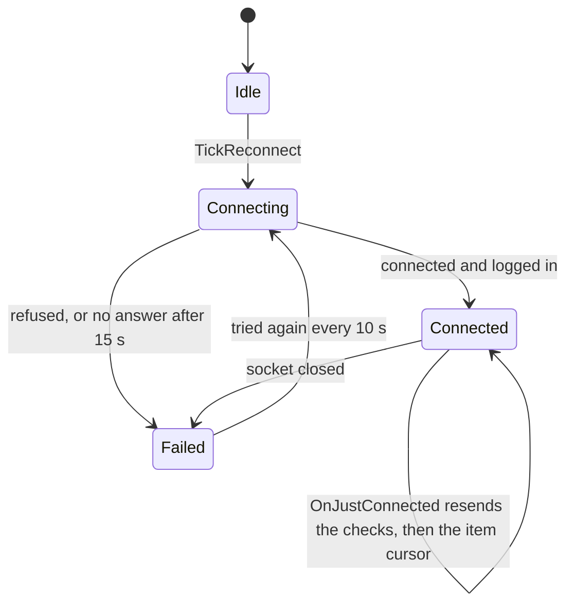

# How the mod works

## Who talks to whom

Only the host connects to the server. A guest never sends a check: what it does goes to the host through the game's own
network.

## A check made by a guest

Nothing in the guest's mod: the game sends the action to the host, which is the authority.

## Losing the server and finding it again

Checks made without a connection are in the save (`ap_reported_*`): they all go again on the next connection.
