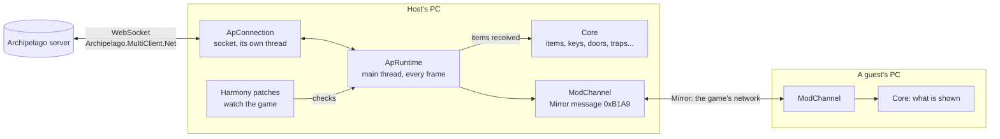
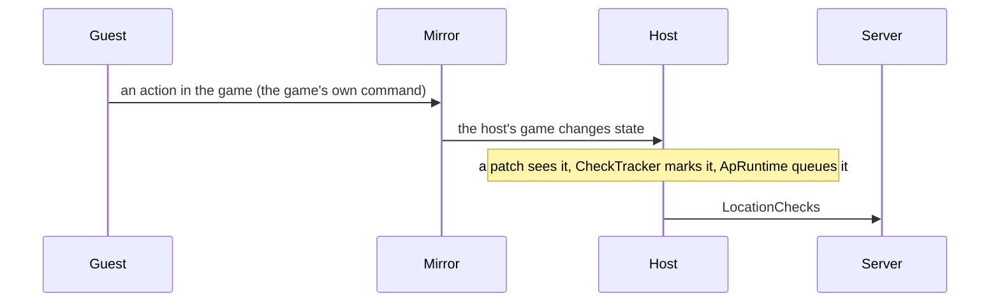
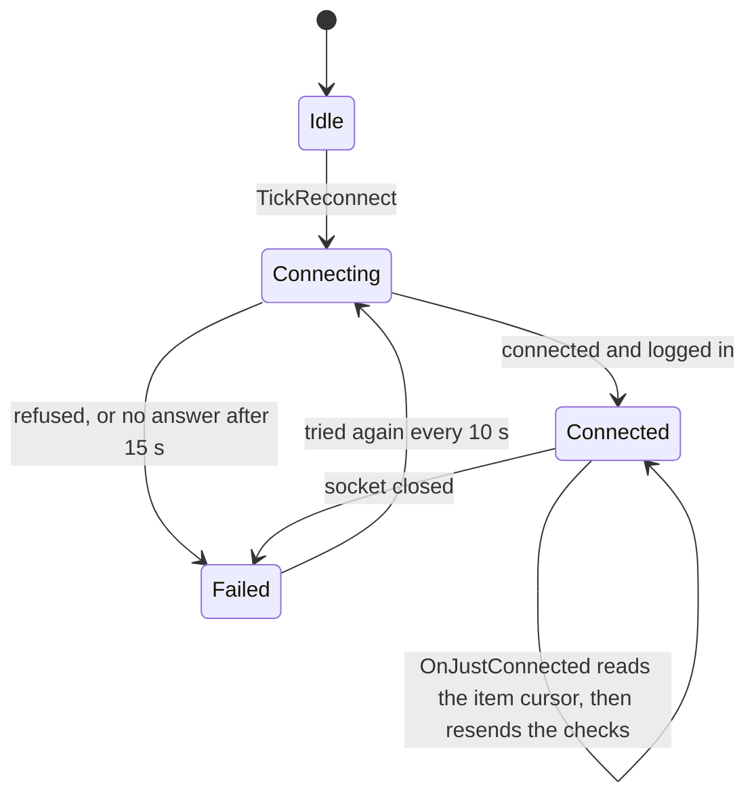

# mod/
## Folders and files
Here is how the structure is made :
**Patches** folder contains only methods that attaches on Big Walk original methods. Every loop code or new functions are located in **Core**.
```
mod/
├── BigWalkArchipelago.sln
├── lib/                  used for developers to create builds of the mod from their own game
├── assets/tiles/         contains every custom tiles asset used in game
├── packaging/            contains licenses and third party notices for the mod and its dependencies
└── src/
    ├── Plugin.cs         declares the mod ressources and applies patches at startup
    ├── Config/           declares every option available in .cfg config file for bepinex mods
    ├── Core/
    │   ├── Net/              contains every related scripts to archipelago server management or mirror netcode operations between players
    │   │   ├── Connection/   contains code to handle archipelago connection with the game
    │   │   ├── Runtime/      contains everything related to resync, send checks, and operations with archipelago server
    │   │   ├── Channel/      contains every custom operations handled by the mod on network
    │   │   └── SlotData/     handles parsing slotdata and get their features available for the mod
    │   ├── Checks/           contains everything related to locations in-game
    │   ├── Items/            contains every code that allows spawning items in game, and removing vanilla ones
    │   ├── Gourds/           allow handling gourd availability, save, despawn them, etc..
    │   ├── Keys/             same as gourds but for keys and their features
    │   ├── Doors/            contains the code to open doors early or lock zones by locking them
    │   ├── Towers/           handles all the code related to towers and their specificities (monument Order, resync stations, etc..)
    │   ├── Puzzles/          handle QoL options for puzzle, and contains related code for puzzle mistakes and hide their logic (with `lock_puzzle_needs` option)
    │   ├── Abilities/        contains code to lock the player movements skills
    │   ├── Effects/          contains everything related to bonus or traps effects in-game
    │   ├── Hub/              contains everything to available hub options (map tracker, teleportation, hint boards, etc...)
    │   ├── Tiles/            contains code to handle the tiles and their randomization in-game
    │   ├── Visuals/          used to store colour randoms and effects related to this
    │   └── Diagnostics/      code used to journalize everything needed in case of bug or anything to help reports being faster
    ├── Patches/          contains every scripts attached to Big Walk's game functions
    │   ├── Compat/           contains code parts to ensure mod ecosystem is going to be feature complete with this one installed
    │   └── Menus/            contains code that modifies in-game menus to allow working features without using unity debug console in-game
    └── Debug/            isn't compiled with release version. Contains every script and functions that allows easier development and can be bound to a key.
```

## But how works connection without a client ?
Big Walk is a Unity game, so it enables me to use BepInEx as a mod manager for this implementation. I reuse Archipelago.MultiClient.Net as a client dll for handling archipelago server connection and functions. 

To make the rest possible, the original game uses Mirror as network API and EOS (Epic Online Services) as a network provider for matchmaking. We won't talk about EOS here since it doesn't changes anything. Mirror works with channels and messages id that are registered at startup to allow game to send messages to everyone who knows those ids. My mod is creating a new message id type (`0xB1A9`) on Mirror and registering it on the network to allow everyone who has this same id to communicate with the.



This way I ensure that everything comes by only one computer : the host one. Host is connected to the archipelago server, and their friends (or not) just need to connect as they play Big Walk normally. 

### What happens if my friend doesn't have the mod ?
A long time ago, it would have disconnected your friend directly at startup...
Because Mirror doesn't allow receiving unknowns ids in the communication channel without knowing them.

Now and since a time, the hosts spawns an object at lobby startup (invisible with a name `Beacon`), every client mod that sees this objects then sends a message with the id type before host tries to speak to them (like a "hello). If the versions mismatch client is informed that his version doesn't correspond to the host's one.


## So if the host handles everything, how a guest could register a location ?
Big Walk contains two types of actions :
- the ones that remains client side and doesn't ask the host the permission to do it
    - those can be lost if there is connections issues
- the other ones where the client will ask the host if they are able to make it like **taking a gourd or completing a puzzle**

So based on this we have this diagram :


This includes also problems when the host is receiving the items, since they have to be replicated on every client machines. This is why I also send items data, traps, doors, etc.. through the channel.

## Losing the server and finding it again
Sometimes it happens that archipelago server's goes down. Developpers are warned that they should have a way to protect game failures when this happens.

Archipelago server's method are runned on a second thread parallel to the game, to avoid it freezing when erroring for any reason, and allowing it to be abandonned and restarted from main thread. 

When the game get disconnected from archipelago (basically socket got closed), it will enter a loop, where it tries to contact the server every 10 seconds. If the server restarts then they reconnect but they still need to reconciliate about their state.

Big Walk when connecting to the archipelago will run methods to resend checks and update the local item cursor to reconciliate with the server.


## Saves and config

Game saves are heavily modified by the mod, every added piece contains the prefix `ap_`. It allows me to not send twice a location to the server.

Config file for archipelago mod contains mostly options that are visible to the player in main menu or in-game by going in the escape menu -> settings -> Archipelago.

## Debugging

Debbuging has multiple levels depending on your instance :
- Release :
    - release journal is composed of two files : `session-journal.tsv` and `LogOutput.log`, the first one is generated by the game mod and contains every locations that has been checked during the playthrough, also deathlink, traps and each state change. The second one is automatically generated when starting BepInEx, but developers can add all kinds of log they want, enabling better research and bug-fixing experience. (Don't worry about sizes, those files rotates when they are too big)
- Debug :
    - developers could ask me for more tools in order to debug the game when developing new features
____

## Build

Requirements: the .NET SDK (tested with 10.0.301) and the local DLLs in
`lib/`: [lib/README.md](lib/README.md) says where each one comes from.

```
dotnet build BigWalkArchipelago.sln
```

Targets `net6.0` to match the BepInEx IL2CPP runtime shipped inside the game
(`.NET 6.0.7`, confirmed in `BepInEx/LogOutput.log`).

## Deployment

Copy **three** DLLs from `src/bin/Debug/net6.0/` into
`<game folder>/BepInEx/plugins/BigWalkArchipelago/`:

- `BigWalkArchipelago.dll`: the mod
- `Archipelago.MultiClient.Net.dll`: the official Archipelago client
- `Newtonsoft.Json.dll`: pulled in by the one above

The last two come from the `Archipelago.MultiClient.Net` NuGet package and
are copied into the build output automatically. Without either of them the
whole mod fails to load.

`tools/deploy-mod.ps1` copies them; `tools/package-mod.ps1` builds in Release
and produces the player zip (BepInEx included).

Launch the game through Steam: running the executable directly does not always
load BepInEx.

## In-game tests

Each version is played before it is published, at two levels:

- **co-op**: on a Debug build of the release commit, with loopback guests on one PC (see
  [Testing on one PC](#testing-on-one-pc)), with or without netsim;
- **smoke test**: the published zip itself, in a clean install, played solo as host: the version and the
  fingerprint in the log, Settings > Archipelago, a room joined, a few checks sent, an item received, no `[Debug]`
  line in the log.

Both binaries are named by their SHA-256 and by the fingerprint `Plugin.Load` writes in the log
(`loaded (build ...)`: the first 16 digits of the DLL's SHA-256). The Release DLL is built from the source of the
same commit (`tools/package-mod.ps1`), but co-op is not played with it: what differs between the two builds is
listed in [Debug and Release builds](#debug-and-release-builds).

What was seen is ticked in an issue made from the
[Release test](../.github/ISSUE_TEMPLATE/release-test.md) template, with the logs of every instance, and the
release links to it. Linux and the Steam Deck are not tested.

## Testing on one PC

Since I don't have as many bucks as true business corporations, I only own the game once: so how could I test
multiplayer? With one license (so you still need to own the game), it is possible to run multiple instances of
the **same Steam install folder**. No trespassing allowed here!

> [!WARNING]
> This is a tool to test the mod, not a way to play co-op with one copy: every player needs their own copy of
> the game. Nothing here starts the game without Steam.

We then use another tool, `netsim`, which controls the traffic of the localhost loop: latency, jitter, losses,
cuts and so on.

It needs a Debug build (`tools/deploy-mod.ps1` builds in Debug by default), `BIGWALK_DIR` set to the game folder,
and `Debug.Enabled = true` in the guest's `.cfg`. netsim needs Python 3.12 or newer.

1. Start the game through Steam and host a world.
2. Start a guest from a terminal:

   ```powershell
   .\tools\launch-guest.ps1                    # joins the host on 127.0.0.1:7777
   .\tools\launch-guest.ps1 -NetSim wifi       # joins through tools/netsim.py on 127.0.0.1:7778
   .\tools\launch-guest.ps1 -NetSim bad -NetSimArgs '--seed 12 --cut 8 --every 60'
   ```

   Run it again for a second and a third guest. Ctrl+L in the host does the same as the script; it goes through
   netsim when netsim already listens on 7778, but it does not start netsim itself.
3. Play. In the netsim window, `c` cuts the link or brings it back, `s` prints the statistics, `q` quits.
4. When the last guest exits, netsim stops and writes its statistics (packets received, sent, lost, cut,
   duplicated, delayed, reordered) to `tools/netsim-logs/`. Attach that log to the test issue.

netsim runs on its own too: `python tools/netsim.py --preset flaky --seed 3`, then start the guests. The presets
are in `tools/netsim-presets.json` (`python tools/netsim.py --list-presets`); each option on the command line
(`--latency`, `--jitter`, `--loss`, `--dup`, `--reorder`, `--rate`) overrides the preset. The same seed gives the
same losses and delays, so a run can be played again.

| Preset | Latency (ms, one way) | Jitter (ms) | Loss | Dup | Reorder | Rate (kbit/s) |
|---|---|---|---|---|---|---|
| `good` | 15 | 2 | 0 % | 0 % | 0 % | no limit |
| `wifi` | 30 | 15 | 1 % | 0 % | 0.5 % | no limit |
| `bad` | 120 | 40 | 5 % | 1 % | 2 % | 2000 |
| `mobile` | 80 | 60 | 2 % | 0.5 % | 1 % | 1000 |
| `flaky` | 50 | 20 | 10 % | 2 % | 3 % | no limit |

**Does the host need `Debug.Enabled`?** No. The game listens on UDP 7777 whenever it hosts, and the loopback
patches run in the guest only. On the host, `Debug.Enabled` only gives the keys: 
- Ctrl+L starts a guest,
- Ctrl+C calls the guests over,
- Ctrl+T switches windows.

But the instances read the same `.cfg`, so the host has
`Debug.Enabled` on too, unless the guest has its own BepInEx: copy `BepInEx` to `BepInEx-guest` once, turn
`Debug.Enabled` on in `BepInEx-guest\config` and off in `BepInEx\config`. `launch-guest.ps1` and Ctrl+L then start
the guest on `BepInEx-guest`, and `deploy-mod.ps1` updates both folders. With the host's `Debug.Enabled` off, start
the guests with the script.

**What it tests**: joining, leaving and coming back; the mod's messages between instances (`ModChannel` over
Mirror); checks and items from either player; what each screen shows; the resync after losing the Archipelago
server. With netsim: latency, losses, duplicates, reordering, and cuts. The game's Kcp timeout is 300 s (the guest
logs it when it joins): a shorter cut freezes the guest, which catches up once the link is back; a longer one
drops it, as a real loss of network would. With losses, a guest that quits may stay frozen on the host until
the 300 s timeout: its leave message was lost. Without losses, it leaves at once.

**What it does not test**: the game's online transport (EpicTransport: EOS lobbies, relays, packet sizes), since
the loopback guests join over Kcp; two Steam accounts, since the instances share one SteamID (the guests send the
host another identifier, see `src/Debug/LoopbackGuest.cs`); two real machines; co-op with the Release binary.

## Debug and Release builds

The Release build leaves out `src/Debug/` (`<Compile Remove="Debug\**" />` in the `.csproj`) and the `#if DEBUG`
lines of the shared code. In a Debug build with `Debug.Enabled = false`, the Debug code is compiled but does not
run: its patches are applied by `Plugin.Load` only when `Debug.Enabled` is on, never by `PatchAll`, and
`tools/check_debug_isolation.py` checks it in CI.

What still differs from Release in a Debug build with `Debug.Enabled = false`:

- the DLL holds the `Debug/` folder's classes (not run);
- the `.cfg` has a `[Debug]` section with `Enabled`, and the debug `.cfg` file is read when it exists (it is
  written only with `Debug.Enabled` on);
- the build is not optimized (`dotnet build` in Debug).
