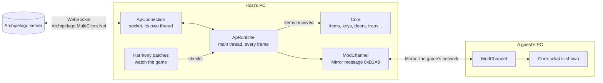
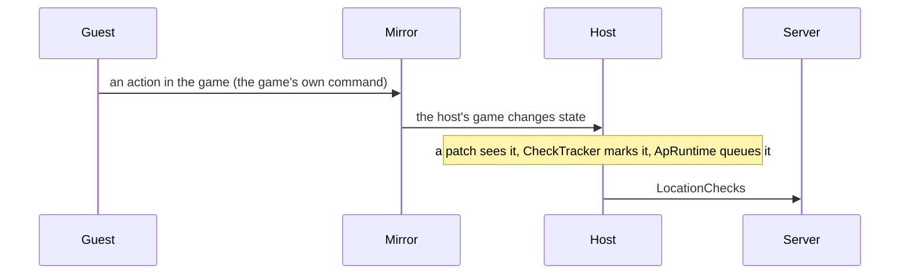
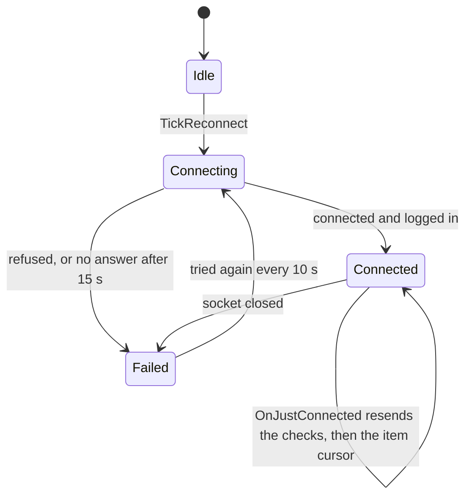

# mod/
## Folders and files
Here is how the structure is made :
**Patches** folder contains only methods that attaches on Big Walk original methods. Every loop code or new functions are located in **Core**.
```
mod/
├── BigWalkArchipelago.sln
├── lib/                  used for developers to create builds of the mod from their own game
├── assets/tiles/         contains every custom tiles asset used in game
├── packaging/            contains licenses and third party notices for the mod and its dependencies
└── src/
    ├── Plugin.cs         declares the mod ressources and applies patches at startup
    ├── Config/           declares every option available in .cfg config file for bepinex mods
    ├── Core/
    │   ├── Net/              contains every related scripts to archipelago server management or mirror netcode operations between players
    │   │   ├── Connection/   contains code to handle archipelago connection with the game
    │   │   ├── Runtime/      contains everything related to resync, send checks, and operations with archipelago server
    │   │   ├── Channel/      contains every custom operations handled by the mod on network
    │   │   └── SlotData/     handles parsing slotdata and get their features available for the mod
    │   ├── Checks/           contains everything related to locations in-game
    │   ├── Items/            contains every code that allows spawning items in game, and removing vanilla ones
    │   ├── Gourds/           allow handling gourd availability, save, despawn them, etc..
    │   ├── Keys/             same as gourds but for keys and their features
    │   ├── Doors/            contains the code to open doors early or lock zones by locking them
    │   ├── Towers/           handles all the code related to towers and their specificities (monument Order, resync stations, etc..)
    │   ├── Puzzles/          handle QoL options for puzzle, and contains related code for puzzle mistakes and hide their logic (with `lock_puzzle_needs` option)
    │   ├── Abilities/        contains code to lock the player movements skills
    │   ├── Effects/          contains everything related to bonus or traps effects in-game
    │   ├── Hub/              contains everything to available hub options (map tracker, teleportation, hint boards, etc...)
    │   ├── Tiles/            contains code to handle the tiles and their randomization in-game
    │   ├── Visuals/          used to store colour randoms and effects related to this
    │   └── Diagnostics/      code used to journalize everything needed in case of bug or anything to help reports being faster
    ├── Patches/          contains every scripts attached to Big Walk's game functions
    │   ├── Compat/           contains code parts to ensure mod ecosystem is going to be feature complete with this one installed
    │   └── Menus/            contains code that modifies in-game menus to allow working features without using unity debug console in-game
    └── Debug/            isn't compiled with release version. Contains every script and functions that allows easier development and can be bound to a key.
```

## But how works connection without a client ?
Big Walk is a Unity game, so it enables me to use BepInEx as a mod manager for this implementation. I reuse Archipelago.MultiClient.Net as a client dll for handling archipelago server connection and functions. 

To make the rest possible, the original game uses Mirror as network API and EOS (Epic Online Services) as a network provider for matchmaking. We won't talk about EOS here since it doesn't changes anything. Mirror works with channels and messages id that are registered at startup to allow game to send messages to everyone who knows those ids. My mod is creating a new message id type (`0xB1A9`) on Mirror and registering it on the network to allow everyone who has this same id to communicate with the.



This way I ensure that everything comes by only one computer : the host one. Host is connected to the archipelago server, and their friends (or not) just need to connect as they play Big Walk normally. 

### What happens if my friend doesn't have the mod ?
A long time ago, it would have disconnected your friend directly at startup...
Because Mirror doesn't allow receiving unknowns ids in the communication channel without knowing them.

Now and since a time, the hosts spawns an object at lobby startup (invisible with a name `Beacon`), every client mod that sees this objects then sends a message with the id type before host tries to speak to them (like a "hello). If the versions mismatch client is informed that his version doesn't correspond to the host's one.


## So if the host handles everything, how a guest could register a location ?
Big Walk contains two types of actions :
- the ones that remains client side and doesn't ask the host the permission to do it
    - those can be lost if there is connections issues
- the other ones where the client will ask the host if they are able to make it like **taking a gourd or completing a puzzle**

So based on this we have this diagram :


This includes also problems when the host is receiving the items, since they have to be replicated on every client machines. This is why I also send items data, traps, doors, etc.. through the channel.

## Losing the server and finding it again
Sometimes it happens that archipelago server's goes down. Developpers are warned that they should have a way to protect game failures when this happens.

Archipelago server's method are runned on a second thread parallel to the game, to avoid it freezing when erroring for any reason, and allowing it to be abandonned and restarted from main thread. 

When the game get disconnected from archipelago (basically socket got closed), it will enter a loop, where it tries to contact the server every 10 seconds. If the server restarts then they reconnect but they still need to reconciliate about their state.

Big Walk when connecting to the archipelago will run methods to resend checks and update the local item cursor to reconciliate with the server.


## Saves and config

Game saves are heavily modified by the mod, every added piece contains the prefix `ap_`. It allows me to not send twice a location to the server.

Config file for archipelago mod contains mostly options that are visible to the player in main menu or in-game by going in the escape menu -> settings -> Archipelago.

## Debugging

Debbuging has multiple levels depending on your instance :
- Release :
    - release journal is composed of two files : `session-journal.tsv` and `LogOutput.log`, the first one is generated by the game mod and contains every locations that has been checked during the playthrough, also deathlink, traps and each state change. The second one is automatically generated when starting BepInEx, but developers can add all kinds of log they want, enabling better research and bug-fixing experience. (Don't worry about sizes, those files rotates when they are too big)
- Debug :
    - developers could ask me for more tools in order to debug the game when developing new features
____

## Build

Requirements: the .NET SDK (tested with 10.0.301) and the local DLLs in
`lib/`: [lib/README.md](lib/README.md) says where each one comes from.

```
dotnet build BigWalkArchipelago.sln
```

Targets `net6.0` to match the BepInEx IL2CPP runtime shipped inside the game
(`.NET 6.0.7`, confirmed in `BepInEx/LogOutput.log`).

## Deployment

Copy **three** DLLs from `src/bin/Debug/net6.0/` into
`<game folder>/BepInEx/plugins/BigWalkArchipelago/`:

- `BigWalkArchipelago.dll`: the mod
- `Archipelago.MultiClient.Net.dll`: the official Archipelago client
- `Newtonsoft.Json.dll`: pulled in by the one above

The last two come from the `Archipelago.MultiClient.Net` NuGet package and
are copied into the build output automatically. Without either of them the
whole mod fails to load.

`tools/deploy-mod.ps1` copies them; `tools/package-mod.ps1` builds in Release
and produces the player zip (BepInEx included).

Launch the game through Steam: running the executable directly does not always
load BepInEx.

## In-game tests

Before a version is published, it is played on two machines with the zip that will be published. What was seen is ticked
in an issue made from the "Release test" template, with the logs of both machines, and the release links to it.
